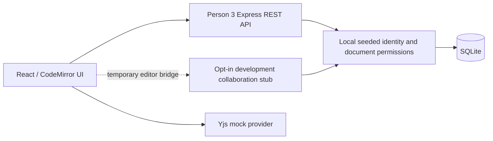
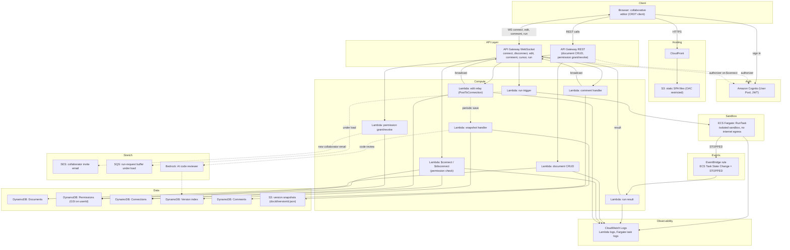

# Architecture

## Current local Person 3 development

See [local setup](docs/local-development.md), [REST contract](docs/person3-api.md)
and [data model](docs/person3-data.md). The local stack below needs no AWS resources.

The stub does not run Python or synchronize different browsers. Replace it and
the mock provider with Person 2's collaboration server for real collaboration.
The read APIs expose Person 2/4 fixtures until those writers are integrated.

## Earlier cloud proposal

The following diagram is retained for historical context. It predates the current
Hocuspocus/Fargate collaboration-server role split and is not the local implementation
or the final deployment contract. Consult the team handoff documents before cloud work.

